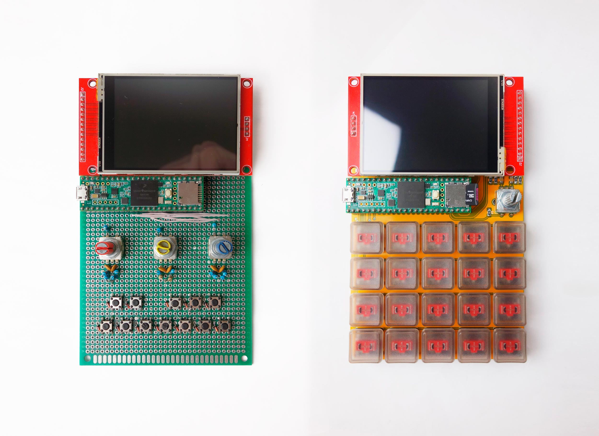
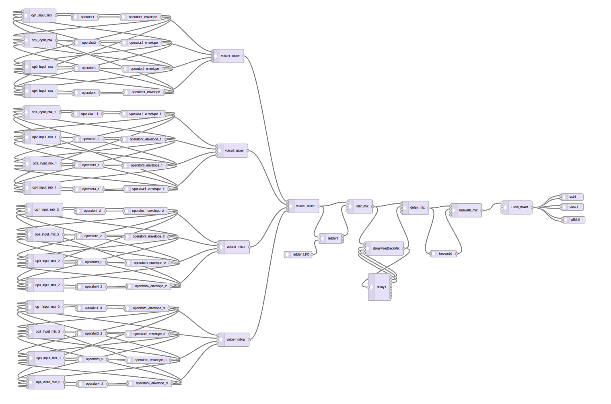

# Teensy synth project

_Listen on YouTube_

This is a project I was working on in 2023. My main goal was to create an interesting object to interact with while learning about software and hardware development. Before starting it, 
I did some small projects with Arduino and assembled a small analogue synth with 3 voices and a low-pass filter. I found the programming part more interesting to me, and it allowed more to be done.
Teensy 3.6 was chosen because it works with the Audio Library and Audio Systems Design Tool, which allow me to work on system design while relying on a professionally written DSP and an easy-to-use design tool to create an audio patch for my synthesizer.
The first version of the project was soldered on a perfboard, as a proof of concept. It worked, so I decided to try to design and manufacture a PCB.

_Perfboard and a PCB versions_

## Hardware
 
| Part | Details |
|------|---------|
| Microcontroller | Teensy 3.6 |
| Display | ILI9341 TFT (320×240, landscape) |
| Keypad | 5×4 matrix of Kailh Choc V1 Low Profile Switches |
| Rotary encoder | to navigate through the menu |
| Audio out | USB audio; the SGTL5000 codec on board was not working, and I was not able to find out why at the time |
| Power | powered through USB |

## Features
 
- **4-voice polyphony**, with 4 operators per voice 
- **11 FM algorithms**, selectable from the display
- **Per-operator controls:** waveform (sine/triangle/square), frequency ratio, level and a full ADSR envelope
- **Effects chain:** low-pass filter with LFO, multi-tap delay with feedback, and Freeverb reverb, each with its own wet/dry mix
- **Step Sequencer:** up to 32 steps, with rests and adjustable BPM
- **On-screen feedback:** algorithm diagram, envelope graphs for every operator and a live output waveform

## How it works
Each voice has 4 operators, each a frequency-modulated oscillator followed by its own ADSR envelope. A mixer in front of every oscillator chooses which operators modulate it.
Then the signal goes through the voice mixer, through the effects, and to one of the outputs.

### Keypad layout
 
 | | Col 1 | Col 2 | Col 3 | Col 4 | Col 5 |
|---|:---:|:---:|:---:|:---:|:---:|
| **Row 1** | Edit / confirm | F♯  | D♯ | C♯| Next |
| **Row 2** | F| E | D | C | Back |
| **Row 3** |Seq play/stop | C♯(+1 oct) | A♯ |  G♯ | - |
| **Row 4** |  C (+1 oct) | B | A  | G | - |

 
- **Notes:** up to 4 notes can sound at once; each new note takes the next free voice.
- **Next / Back:** switch screens, or step through parameters while editing.
- **Edit / confirm:** enter or leave editing for the highlighted item.
- **Seq play/stop:** starts or stops the sequencer from any screen.
  
### Screens

Use **Next / Back** (when not editing) to move between screens.
 
**1. Synth.** Turn the encoder to highlight **OCT**, **ALG** or **OP-1 … OP-4**, then press **Edit** to change it.
For an operator, **Next / Back** step through the parameter being edited, and the encoder changes its value:
 
| Parameter | Range |
|-----------|-------|
| Attack | 0–1000 ms |
| Decay | 0–1000 ms |
| Sustain | 0.0–1.0 |
| Release | 0–3800 ms |
| Ratio | 0–16 (frequency multiple of the played note) |
| Level | 0.0–1.0 |
| Waveform | sine / triangle / square |
 
**2. Effects.** Pick **Reverb**, **Delay** or **Filter** with the encoder, press **Edit**, use **Next / Back** to move the arrow between parameters and the encoder to change them:
 
| Block | Parameters |
|-------|------------|
| Reverb | room size (0–1), damping (0–1), wet/dry |
| Delay | taps (0–3), time (10–500 ms), feedback (0–0.5), wet/dry |
| Filter | cutoff (0–5000 Hz), resonance, wet/dry, LFO rate (0–50 Hz) |
 
**3. Step Sequencer.** Pick **Record**, **Steps** or **BPM** with the encoder:
 
- **Record:** press **Edit** to start/stop recording. Play notes to write them into the sequence; **Next / Back** write a rest.
- **Steps:** sequence length, 1–32.
- **BPM:** tempo of the step clock.
- The Sequencer plays on a single voice (monophonic).

### Project problems

- SGTL5000 codec. While I was working on a project, there was a chip shortage, and I was only able to buy it from a sketchy AliExpress supplier. Either this or my poor, at the time, soldering skills, I was not able to make it work, and USB was the only audio output that was working.
- Code. It was my first attempt to do something complex. I had no experience and made a lot of bad design choices, but it somehow works, which is cool.
- PCB. Besides a problem with a codec, it's also my first PCB, routing is bad and probably anyone with any experience will find a lot of mistakes.

### Planned upgrades

At some point, I decided that the PCB needs serious upgrades, and there is no point in continuing to write code if I will make major changes to the hardware.
You can see files for the upgraded PCB in [`PCB files/teensy_4_1_pcb/`](PCB%20files/teensy_4_1_pcb/).
What was made:
- I decided to switch from a display module to a bare screen. It allowed me to reduce the synth's size.
- I removed 5 keys. In the last design, part of the keys were not used at all, which again reduced the size.
- SGTL5000 was changed to PT8211, it's easier to use, cheaper, and good enough for my tasks.
- Added battery support. I copied this part of the schematic from another synth that used a Teensy.

This board was never manufactured. At the time, I changed jobs, and there was no time to continue work on it.
